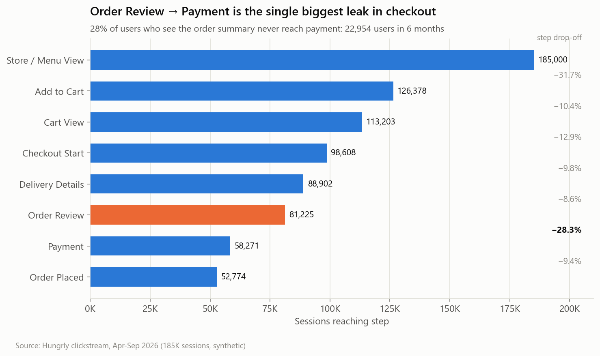
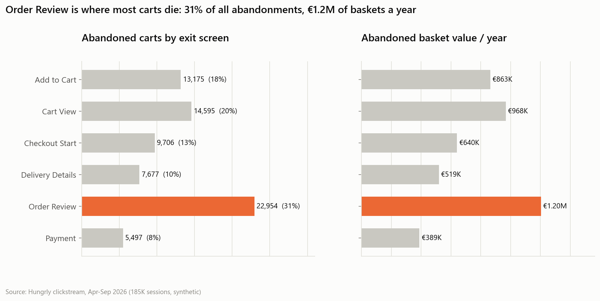
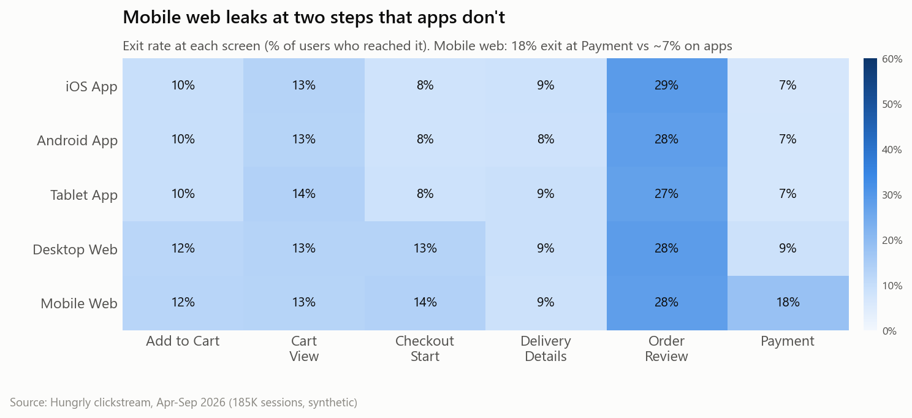
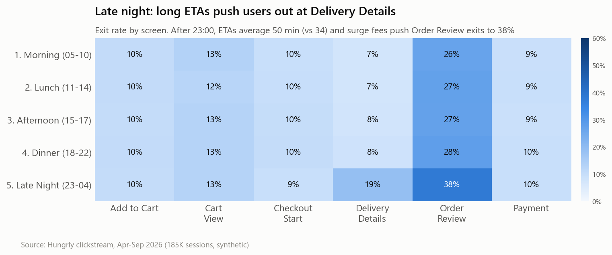
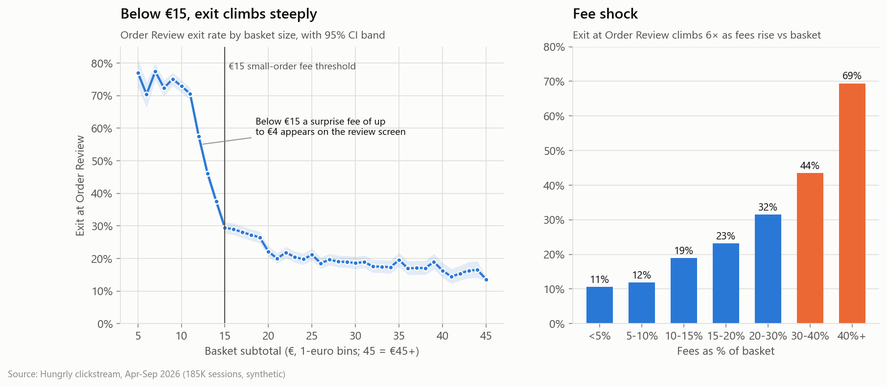
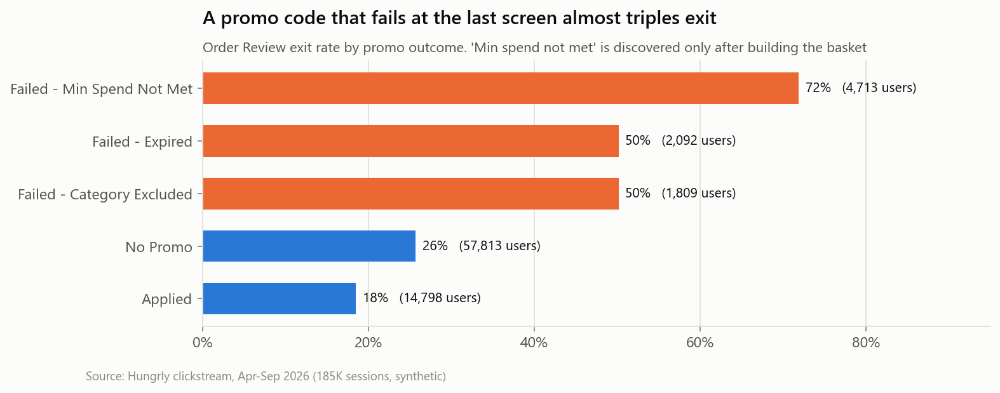
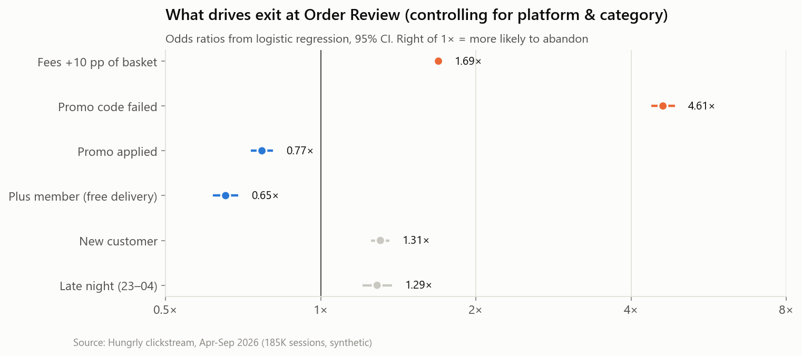
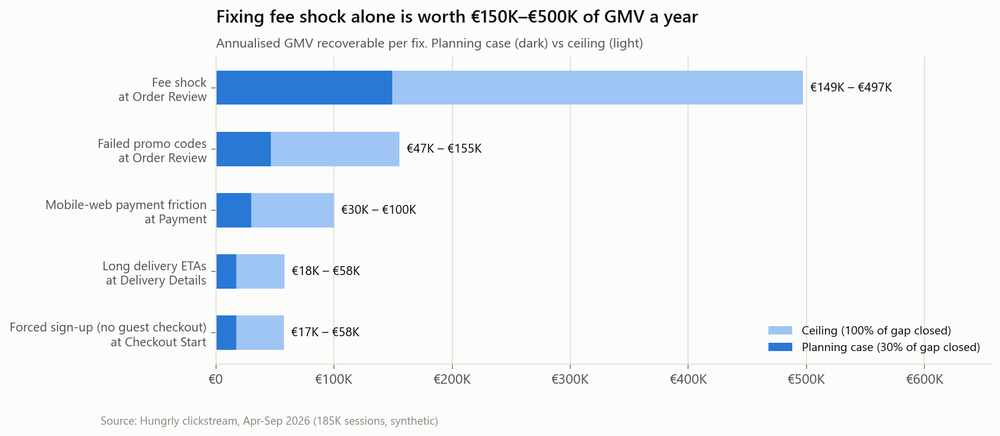

# Cart Abandonment Pattern Analysis: Where Checkout Breaks and What to Fix

**Product Analytics case study** · SQL · Python · Power BI

> **Business question:** *Where in the checkout flow are customers dropping off the most, and what should the product team fix first?*

**Answer in one line:** customers leave at **Order Review**, the first screen that shows the real price. **28% of everyone who
reaches it walks away**, which is **€1.2M of baskets a year**. Two fixes on that one screen (show fees and promo eligibility
earlier) are worth an estimated **€196K–€652K in GMV per year**.

**🔗 Live interactive dashboard: [hungrly-checkout-leaks.vercel.app](https://hungrly-checkout-leaks.vercel.app)** · Code: [GitHub](https://github.com/Harnoor001/cart-abandonment-analysis) · Power BI report: [`data/powerbi/Hungrly_Checkout_Funnel.pbix`](data/powerbi/Hungrly_Checkout_Funnel.pbix)

| 185K | 58.2% | 28.3% | €1.2M / yr | 4.6× |
|:---:|:---:|:---:|:---:|:---:|
| sessions analysed | cart abandonment | exit at Order Review<br>(worst step, 2–3× any other) | baskets abandoned at Order Review | odds of leaving when a promo code fails |



---

## Contents
1. [Context & data](#1-context--data)
2. [Approach](#2-approach)
3. [Findings](#3-findings)
4. [Recommendations](#4-recommendations-for-the-product-team)
5. [How to prove it: A/B test plan](#5-how-to-prove-it-ab-test-plan)
6. [Power BI dashboard](#6-power-bi-dashboard)
7. [Repo structure & how to run](#7-repo-structure--how-to-run)
8. [Limitations & next steps](#8-limitations--next-steps)

---

## 1. Context & data

**Hungrly** is a fictional European food & grocery delivery app (Berlin, Paris, Madrid, Amsterdam, Milan, Dublin).
Every session moves through an 8-step checkout:

```
Store/Menu View → Add to Cart → Cart View → Checkout Start → Delivery Details → Order Review → Payment → Order Placed
                                               (login wall)     (ETA / slot)      (fees + promo     (card / wallet
                                                                                   revealed here)    + 3-D Secure)
```

| Table | Rows | Grain |
|---|---|---|
| `sessions` | 185,000 | one visit: platform, device, city, traffic source, new vs returning |
| `events` | 832,990 | one funnel event (`add_to_cart`, `order_review`, `promo_code_failed`, `payment_failed`, …) |
| `carts` | 126,378 | basket: category, subtotal, delivery / service / small-order fees, promo outcome, ETA |
| `orders` | 52,774 | completed order |
| `users` | 51,835 | customer, Plus membership |

> **About the data.** Real checkout logs are confidential, so the dataset is **synthetic**, generated by
> [`src/generate_data.py`](src/generate_data.py) with realistic seasonality (lunch/dinner peaks, weekends, an August dip),
> fee rules, promo rules and platform behaviour. The generator encodes behavioural *mechanisms* (e.g. "users react to fees
> relative to basket size"). It does not hard-code the conclusions; every number below was discovered through the analysis.
> Swap in real event data with the same schema and the whole pipeline runs unchanged.

## 2. Approach

```
 Raw events (CSV) ──► SQLite + analysis view ──► 15 SQL queries ──► Python: stats, model, charts ──► Power BI dashboard
   src/generate_data    sql/01_schema.sql         sql/02–05           notebooks/                      powerbi/
```

1. **Data quality first.** 8 integrity checks (orphan sessions, skipped steps, duplicate events, out-of-order timestamps…). All pass.
2. **Funnel & exit screens** in SQL (CTEs, `LAG`/`FIRST_VALUE`/`RANK` window functions).
3. **Segmentation** by platform, device, category, time of day and new vs returning, with Wilson confidence intervals.
4. **Root cause** at the worst step: fees, basket size, promo outcome.
5. **Validation:** chi-square and two-proportion z-tests, plus a **logistic regression** that controls for confounders.
6. **Opportunity sizing:** benchmark each problem segment against a healthy one, adjust for downstream conversion, annualise,
   then cross-check with model-based counterfactuals.
7. **Experiment design** with a power analysis for the top recommendation.

## 3. Findings

### Finding 1: Order Review is the single biggest leak
28.3% of users who reach Order Review never reach Payment, versus 8–13% at every other checkout step. It accounts for
**31% of all abandoned carts and €1.2M of abandoned baskets a year**.



### Finding 2: "Mobile vs laptop" is the wrong cut; native app vs mobile web is the right one
At device level the gap looks small (Mobile 58.1% vs Desktop 60.5% abandonment). Split by platform and **mobile web abandons
64.5% of carts vs 55–56% on the apps**. Mobile web leaks at two specific steps:
- **Payment:** 18% exit vs ~7% on apps. Card payments on mobile web fail **24%** of the time on first attempt (3-D Secure
  redirect, no Apple/Google Pay) vs 3% for wallet payments. χ² = 1,411, p < 0.001.
- **Checkout Start:** new web users hit a forced sign-up. **33% leave**, vs 11.5% of new app users (z = 39.8).



### Finding 3: Late night doubles the leak at Delivery Details
After 23:00 the average ETA jumps from 34 to 50 minutes and surge fees kick in: Delivery Details exits rise from 7–8% to **19%**
and Order Review exits to **38%**. Exits climb from 6% (ETA < 30 min) to 22% (ETA 60+ min).



### Finding 4: Root cause is fee shock and broken promo promises
- **Fee shock.** Order Review exit climbs **6×**, from 11% when fees are under 10% of the basket to **69%** when they're over 40%.
  Baskets under the **€15 small-order threshold** (a surprise fee of up to €4) exit at 56–74%.
- **Broken promise.** When a promo code fails at the last screen, exit jumps to **50–72%** vs 26% with no promo. *"Min spend not
  met"* is the worst: the user built a basket to get the discount and learned only at the end that it doesn't qualify.




### Finding 5: It's not the category, it's the fee-to-basket ratio
Desserts & Coffee (72%) and Fast Food (64%) look like problem categories. In a logistic regression on 81K Order Review
sessions, Desserts & Coffee's odds ratio drops from **6.4× to 1.04×** once fees and promos are controlled for. Small baskets
are the issue, not the menu. Each **+10 pp of fees relative to the basket multiplies the odds of leaving by 1.7×**; a failed promo
by **4.6×**; Plus members (free delivery) have 35% *lower* odds of leaving, which is direct evidence that price, not intent, drives the exit.



### Finding 6: What each leak is worth
Method: *(segment exit rate − benchmark exit rate) × users affected × downstream conversion × AOV*, annualised.
The planning case assumes 30% of the gap is closed; the ceiling assumes 100%.

| Leak | Step | Problem vs benchmark exit | Relative risk | Annual GMV (30% → 100%) |
|---|---|---|---|---|
| Fee shock (fees ≥ 15% of basket) | Order Review | 40.2% vs 11.6% | 3.5× | **€149K – €497K** |
| Failed promo codes | Order Review | 62.1% vs 25.7% | 2.4× | **€47K – €155K** |
| Mobile-web payment friction | Payment | 18.2% vs 6.8% | 2.7× | **€30K – €100K** |
| Long delivery ETAs (50+ min) | Delivery Details | 16.7% vs 6.5% | 2.6× | **€18K – €58K** |
| Forced sign-up, new web users | Checkout Start | 32.8% vs 11.5% | 2.8× | **€17K – €58K** |

**Sanity check:** a regression counterfactual (resolve promo failures + remove the small-order-fee surprise) gives **≈ €205K/yr**,
right next to the €196K planning case for the two Order Review fixes. The planning case is realistic, not a stretch.



## 4. Recommendations for the product team

| # | Fix | Why (evidence) | Value / yr | Effort |
|---|---|---|---|---|
| **1** | **Show the all-in price on the cart screen**, plus a progress bar: *"Add €3.20 more to skip the small-order fee"* | Exit rises 11% → 69% with fee ratio; OR 1.7× per +10 pp | €149K–€497K | Medium |
| **2** | **Validate promo codes in the cart** and show min-spend progress: *"€4.20 more to unlock 20% off"* | Failed promo exit 62% vs 26%; OR 4.6× | €47K–€155K | Low |
| **3** | **Apple Pay / Google Pay on mobile web**, inline 3-D Secure | Card failure 24% on mobile web; payment exit 18% vs 7% | €30K–€100K | Medium |
| **4** | **Show ETA on the store page**; offer scheduled delivery late at night | Exit 6% → 22% as ETA grows | €18K–€58K | Low |
| **5** | **Guest checkout** for new web users (create the account after the order) | 33% of new web users exit vs 11.5% on app | €17K–€58K | Medium |

**Start with #1 and #2.** They share a root cause (*users discover the real price at the last moment*) and a screen, and
together they hold more than two-thirds of the recoverable value. #1 should also *raise* AOV, because the nudge pushes small
baskets over €15.

## 5. How to prove it: A/B test plan

| | |
|---|---|
| **Hypothesis** | Showing fees and promo eligibility in the cart reduces late-stage abandonment without simply moving exits earlier |
| **Primary metric** | Cart → order conversion (baseline 41.8%). Captures exits that shift upstream |
| **Secondary** | Order Review exit rate, AOV, share of baskets just above €15 |
| **Guardrails** | Fee revenue per order, Cart → Checkout Start rate, support contacts |
| **Size** | +2 pp MDE, α = 0.05, power = 0.8 → **9,604 carts per arm ≈ 4 weeks** at ~690 carts/day (+1.5 pp needs ~7 weeks) |

## 6. Dashboards

### Live web dashboard (Vercel)
**🔗 Live demo: [hungrly-checkout-leaks.vercel.app](https://hungrly-checkout-leaks.vercel.app)**

[`web/`](web) is a static, interactive version of the whole case study (HTML + D3, no build step). Filter the funnel by any
segment, switch the heatmap between platform / device / category / time of day / customer type, hover any mark for exact
numbers, and drag the gap-closure slider to re-size the opportunity live. Light and dark mode, works on phones.
Its data (`web/data/dashboard.json`) is exported by `src/export_web_data.py`, so the site always matches the SQL and notebook.

```bash
python -m http.server 5173 --directory web     # preview locally
cd web && npx vercel --prod                    # deploy
```

### Power BI

The semantic model is built: 5 tables loaded from `data/powerbi/` through a `DataFolder` Power Query parameter, 3
relationships, a marked date table, sort orders, a **Segment By** field parameter, a **Gap Closure** what-if table and
**34 DAX measures** in display folders. All measures were checked against the SQL output.
Four report pages follow the exec's reading order: **Overview → Segment Explorer → Root Cause → Fix It**.
- Funnel with a dynamic headline (*"Order Review is the biggest leak: 28.3% of users leave there…"*) and auto-highlighting of the worst step
- Field-parameter heatmap: one matrix answers device, category, time of day and customer type
- Decomposition tree + Key Influencers on Order Review exits
- What-if slider for gap closure → live recoverable-GMV estimate

Everything you need to build it is in [`powerbi/`](powerbi): the [build guide](powerbi/POWERBI_BUILD_GUIDE.md) (model, page
layouts, expected values to check your numbers), [30+ DAX measures](powerbi/measures.dax) and a [theme](powerbi/hungrly_theme.json).
Data: `data/powerbi/` (star schema exported by `src/export_powerbi.py`).

## 7. Repo structure & how to run

```
├── run_pipeline.py                  # one command rebuilds everything (~2 min, seed 42)
├── src/
│   ├── generate_data.py             # synthetic clickstream with behavioural mechanisms
│   ├── build_database.py            # CSV → SQLite
│   ├── run_sql_analysis.py          # runs every "-- name:" query → outputs/sql_results/
│   ├── export_powerbi.py            # star schema for Power BI
│   ├── export_web_data.py           # JSON for the web dashboard
│   └── viz_style.py                 # shared chart style
├── sql/
│   ├── 01_schema.sql                # tables + vw_session_funnel (one row per session)
│   ├── 02_funnel_overview.sql       # funnel, exit screens, KPIs, weekly trend
│   ├── 03_dropoff_by_segment.sql    # platform / device / category / time / customer type
│   ├── 04_root_cause.sql            # fees, basket size, promos, login wall, ETA
│   └── 05_revenue_impact.sql        # € abandoned by step + opportunity sizing
├── notebooks/cart_abandonment_analysis.ipynb   # full analysis, executed with outputs
├── powerbi/                          # DAX measures, theme, build guide
├── web/                              # live dashboard: index.html, app.js, styles.css, data/, vercel.json
├── outputs/sql_results/              # every SQL result as CSV
├── reports/figures/                  # all charts
└── data/                             # raw/, powerbi/ (large files git-ignored, regenerate)
```

```bash
pip install -r requirements.txt
python run_pipeline.py
```

**SQL techniques used:** CTEs, window functions (`LAG`, `FIRST_VALUE`, `RANK`, `SUM() OVER ()`), conditional aggregation,
`UNION ALL` reshaping to long format, `CROSS JOIN` scaffolding, analysis views, data-quality assertions.
**Python:** pandas, statsmodels (logit, power analysis, Wilson CIs, z-tests), scipy (χ²), matplotlib.

## 8. Limitations & next steps

- **Synthetic data.** Effects are cleaner than in production. Real data would need bot filtering, session stitching across
  devices and handling of users who return later to complete the same cart (*"abandoned" vs "deferred"*).
- **Observational, not causal.** The regression controls for observed confounders only. The A/B test is how causality gets proven.
- **GMV ≠ profit.** Sizing is in GMV; multiply by take rate (≈ 15–25%) plus fees for net revenue. Fee changes need a margin model.
- **Next:** cohort view (do abandoners come back within 7 days?), recovery-email uplift analysis, and a session-replay review of
  Order Review to design the new cart screen with UX research.
